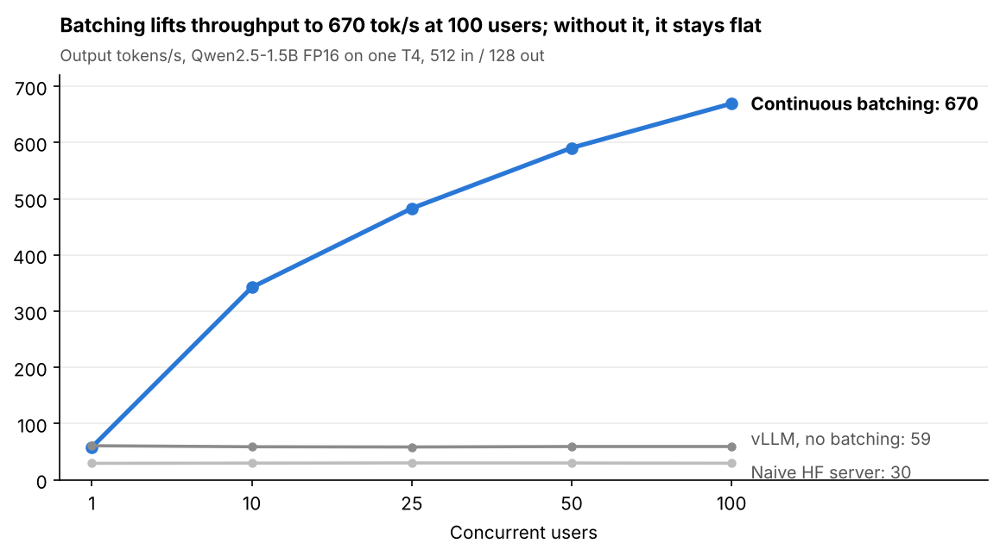
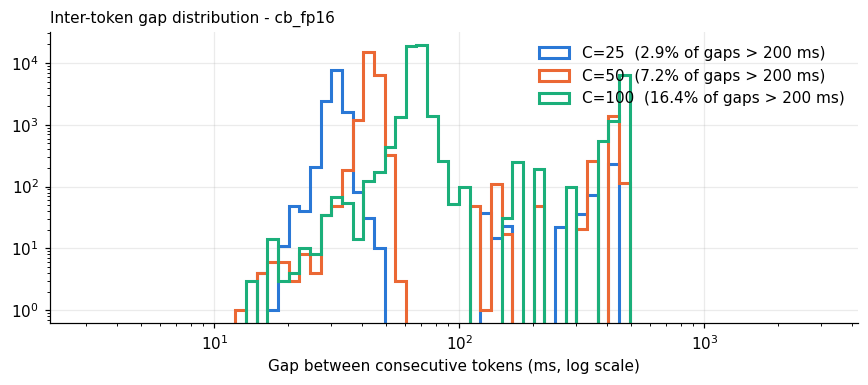
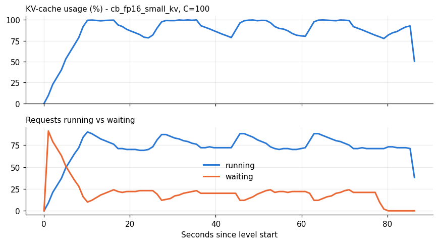

# efficient-inference

An asynchronous load-testing and profiling framework for LLM serving, with 8 experiments run on a single 15 GB T4 GPU (Google Colab free tier). It measures how serving behaves as concurrent users grow from 1 to 100, and which optimizations actually help.

**Full report:** [Serving LLMs Under Concurrent Load on a Single T4](docs/efficient-inference-report.pdf)



## Key results

Qwen2.5-1.5B-Instruct (FP16 unless noted), vLLM 0.33.0. Every request used a 512-token prompt and a 128-token answer.

| Finding | Result |
| --- | --- |
| Naive HF server to vLLM with continuous batching, 100 users | **22.6x throughput** (2.0x engine x 11.3x batching) |
| Prefix caching on a shared 448-token prompt, 50 users | **+68% throughput**, TTFT p95 4.1x lower |
| KV cache too small for the load, 100 users | -12% throughput, but **steady-state TTFT p95 6.6x worse** |
| AWQ 4-bit vs FP16 weights | 1.86x throughput at 1 user, **0.97x at 100** |
| Decode cost model, fitted across 0.5B / 1.5B / 3B | **4.6 ms + 4.1 ms per GB of weights** per token (~240 GB/s, 76% of T4 peak) |
| Generation stalls, 100 users, default settings | **16.4% of token gaps** stalled ~450 ms (18% predicted from first principles) |

**Main conclusion:** optimizations come in two kinds.

- **Capacity** optimizations raise the work done per second, so total latency falls. Examples: batching, a better engine, prefix caching, quantization when memory-bound, a smaller model.
- **Distribution** optimizations leave the work unchanged and only decide who waits, and when. Examples: the chunked-prefill budget, admission control.

Once the GPU is saturated, only the first kind reduces latency (Little's law).

| Generation stalls | KV-cache starvation |
| --- | --- |
|  |  |
| Prompt processing interrupts answers in progress: token gaps split into normal steps and stall clusters. | With 48,080 tokens of KV capacity, at most ~75 requests run at once; the rest wait. |

## Experiments

| # | Experiment | Question |
| --- | --- | --- |
| 1 | Concurrency sweep, 1-100 users | How do engine, batching, KV capacity and quantization change throughput and latency? |
| 2 | Prefix caching | What does reusing a shared prompt prefix save? |
| 3 | Static vs continuous batching | What does continuous batching buy when answer lengths vary? |
| 4 | KV cache on vs off (HF) | What does the KV cache itself save? |
| 5 | Chunked-prefill budget | How does step size trade first-token time against stalls? |
| 6 | Prompt length, vLLM vs HF | Why is vLLM's first token slower at one user? (Attention kernel on sm75; my first prediction was falsified) |
| 7 | Model size, 0.5B / 1.5B / 3B | How does decode time scale with weight bytes? |
| 8 | Admission control | What does capping concurrent sequences trade? |

## Quick start (Colab)

1. Open `Efficient_AI_Inference.ipynb` in Colab and pick the **T4 GPU** runtime.
2. Run cells 1-5: GPU check, Drive mount, install, write the framework to Drive, load the plan. After the install cell, restart the session once.
3. Run cell 6, a 3-minute smoke test. `n_failed` and `output_len_mismatch` must both be 0.
4. Run the experiment cells (7-14). Each one is resumable: if Colab disconnects, re-run setup and the same cell.
5. Run the analysis cells (15) on any runtime, CPU included.

About 3 hours of T4 time in total; two sessions fit the free tier.

## Layout

```
configs/experiments.yaml   the plan: model, workload, configs per experiment
infbench/workload.py       fixed-length prompts (token IDs) from the systalyze coding corpus
infbench/server.py         vLLM / HF server subprocess: start, health check, stop, KV capacity and memory from logs
infbench/hf_server.py      naive baseline: transformers + HTTP, one request at a time
infbench/loadgen.py        asyncio/aiohttp streaming client, closed loop or static "waves"
infbench/monitor.py        1 Hz sampler: NVML, psutil, vLLM /metrics (KV usage, queue, preemptions, prefix hits)
infbench/metrics.py        TTFT / ITL / TPOT / E2E percentiles (ms), steady-state TTFT, throughput (tok/s)
infbench/runner.py         experiment driver, resumable, writes summary.csv + raw per-request JSONL
infbench/analyze.py        plots, comparison tables, steady-state recomputation, ITL histograms
infbench/kv_ablation.py    HF decode loop with vs without KV cache
build_notebook.py          regenerates the notebook from these files
results/<experiment>/      summary.csv per experiment (raw JSONL and logs are .gitignored)
docs/figures/              figures used in this README and the report
```

## Methodology notes

- **Fixed lengths:** prompts are exactly 512 tokens, sent as token IDs. Answers are exactly 128 tokens (`min_tokens = max_tokens`). Configs differ only in how they serve.
- **Like-for-like inputs:** every config replays the same unique prompts at each load level. Prefix caching is off except in Experiment 2.
- **Steady-state TTFT:** all C users start at once at each level, so the first cohort is excluded from steady-state TTFT. At 100 users that cohort inflated TTFT p95 5x.
- **Bimodal latency:** inter-token gaps have two clusters, so p99 and the stall share are reported alongside p95.
- **Memory signal:** NVML GPU utilization read ~100% even at one user, and vLLM preallocates VRAM. KV-cache usage is the memory signal that actually changes with load.

## Limitations

- Closed-loop load with a burst start, not open-loop Poisson arrivals.
- Fixed answer lengths in most experiments, which synchronize completions and exaggerate stall size.
- One GPU generation (T4, sm75) and one model family (Qwen2.5).
- Output quality was not measured.
- The attention-kernel explanation in Experiment 6 has not been verified with kernel profiling.

## Acknowledgements

- [systalyze/vllm-benchmarks](https://github.com/systalyze/vllm-benchmarks): the coding corpus (downloaded at runtime, not redistributed) and the fixed-output-length method.
- [Alt-Shivam/vllm-benchmarking-studio](https://github.com/Alt-Shivam/vllm-benchmarking-studio): the sweep structure over concurrency and request counts.

## License

MIT. See [LICENSE](LICENSE).
